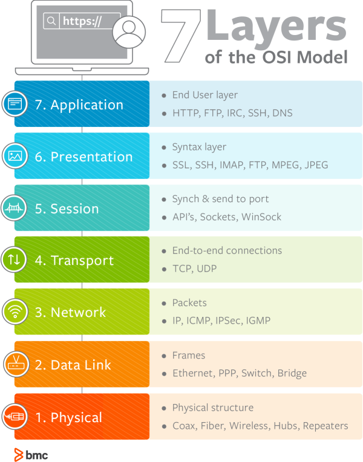
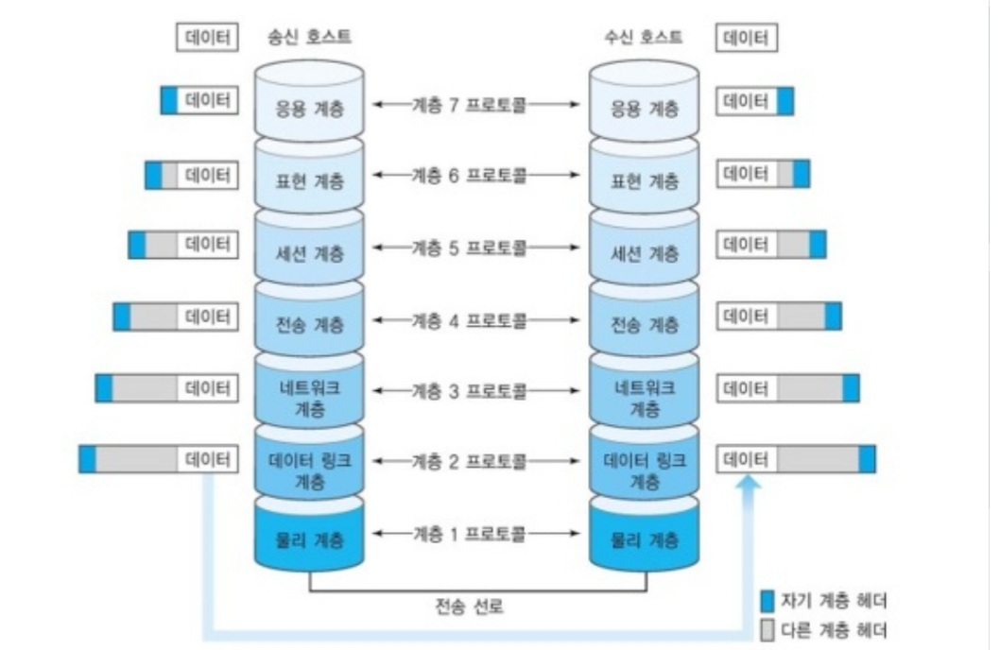
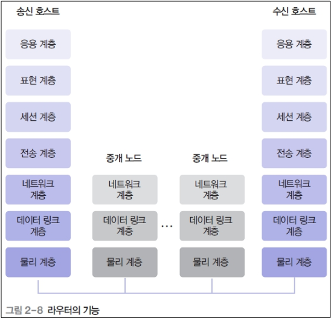

# 프로토콜의 이해
네트워크에 연결된 시스템이 통신하려면 정해진 규칙에 따라 순차적으로 데이터를 주고 받아야 하는데, 이러한 일련의 규칙을 프로토콜(Protocol)이라 한다.

## 계층적 모듈 구조
일반적으로 복잡하고 큰 시스템의 기능은 특정 단위의 모듈로 나누어 설계한다. 각 모듈은 독립적으로 동작하면서 상호 유기적으로 통합될 수 있어야 하기 때문에 모듈과 모듈을 서로 연동해 동작시키는 적절한 인터페이스가 필요하다.

### 모듈화
컴퓨터를 하드웨어 측면에서 보면 CPU, 메모리, 하드디스크, LAN 카드 등과 같은 작은 부품이 모여 하나의 시스템을 이룬다. 이렇게 모듈화하면 시스템 구조가 단순해져 전체 시스템 이해가 쉽고 각 모듈이 독립적인 기능을 수행하기 때문에 유지 보수가 간편하다.

소프트웨어 측면에서 보면, 프로그래밍 언어에서 함수 개념을 사용해 함수별로 특정 기능을 독립적으로 수행하도록 함으로써, 각 함수가 개별적으로 설계되고 구현된다는 장점이 있다. 함수 사이의 인터페이스는 함수의 매개변수에 의해서만 이루어지기 떄문에 전체를 이해하기 쉽다.

즉, 각 함수의 역할이 매개변수로 추상화되므로 내부를 보지 않고도 함수들을 이해할 수 있고, 이들의 모임인 전체 시스템도 쉽게 이해할 수 있다.

### 계층 구조

> [모듈화된 계층 구조](https://velog.io/@kkk792100/네트워크-개념)

계층 구조는 상위 계층이 하위 계층에 특정 서비스를 요청하는 방식으로 동작하며 요청을 받은 하위 계층이 해당 서비스를 실행해 결과를 상위 계층에 돌려준다. 이 돌려주는 방식은 직접 전달하거나 주변 환경 값을 변경하는 부수 효과(Side Effect) 방식일 수도 있다.

이렇게 모듈화된 계층 구조는 모듈화의 장점처럼 이해하기 쉽고 구현이 쉽다 등이 있지만, 계층 간 데이터를 처리하며 생기는 오버헤드 단점이 있다.

## 프로토콜 설계 시 고려 사항
- 네트워크 호스트의 주소 표현 : 시스템을 구분하기 위해 이름을 부여하는 것
- 데이터 전송 과정 오류 제어 : 네트워크 오류는 발생할 수밖에 없다.
-  통신 양단 사이의 전송 속도를 제어하는 흐름 제어(속도가 서로 다르면 안된다)
-  데이터 전달 방식

### 주소 표현
여러 호스트가 연결된 환경에서 특정 호스트끼리 통신하기 위해 상대방을 구분하는 방법이 필요하다.

보통 하나의 호스트마다 주소를 부여하지만, 다수의 호스트를 묶어 그룹 주소로 표기하도 한다. 이는 전통적인 통신 환경이면서 현재도 가장 많이 사용하는 1:1 통신과 더불어, 화상 회의 등을 위한 1:n 통신 환경도 필요하기 때문이다.

1:n 통신 방식의 대표적인 예로 브로드캐스팅(Broadcasting) 방법과 그룹으로 묶어 지칭하는 멀티캐스팅(Multicasting) 방법이 있다.

### 오류 제어
데이터 송수신 과정에서 발생하는 오류로 데이터가 깨져서 도착하는 변형 오류, 데이터가 도착하지 않는 분실 오류가 있다.

오류 제어는 먼저 (1)데이터의 오류를 인식하고 (2)데이터를 재전송하는 기본적인 해결방식으로 이루어진다.

**오류 제어를 위해 필요한 요소**
- 응답(Acknowledgement) 신호
- 타임아웃(TimeOut)
- 재전송(Retransmission)
- 순서번호(Sequence Number)

> [오류 제어](https://velog.io/@kkk792100/네트워크-개념)

위 그림에서 (b)의 경우와 같이 송신자가 보낸 데이터가 수신측으로 도착하지 않은 경우, 수신측에선 데이터 분실이 발생했단 사실을 인지하지 못한다. 그래서 보통 수신측으로부터 응답신호를 일정 시간 받지 못한 경우 분실 오류가 발생했다 판단하고 송신측은 데이터를 재전송한다.

(c)와 같이 데이터가 도착했으나 전송 과정에서 데이터가 변형된 경우, 수신측에서 CRC와 같은 오류 검출 기법을 이용해 오류를 검출할 수 있다.

즉, 데이터 분실 오류를 해결하는 것은 송신측 주도로 이루어지고 데이터 변형 오류는 수신측 주도로 이루어진다.

만약 오류 발생을 감지하고 데이터를 재전송 하였으나 응답 신호가 분실되는 경우, 수신측에 도착한 데이터는 중복될 수 있다. 수신측에선 이 데이터가 다음 데이터인지 아니면 재전송된 데이터인지 구분할 수 없기 때문에 순서 번호를 사용해 해결한다.

### 흐름 제어
수신 호스트의 버퍼 처리 속도보다 송신 호스트가 데이터를 전송하는 속도가 빠르면 논리적인 데이터 분실 오류가 발생한다. 수신 호스트가 버퍼에 저장된 데이터를 처리하지 못한 상태에서 새로운 데이터가 수신되어 일시적으로 저장할 공간이 없기 때문이다. 이를 해결하기 위해 흐름 제어 기능이 필요하다.

> [흐름제어](https://velog.velcdn.com/images/kkk792100/post/9c0eafe6-219e-46f1-add2-4d49658ebe00/image.png)

위 그림은 가장 단순한 형태의 흐름 제어 방식으로 송신 호스트가 데이터를 전송하기 전, 수신 호스트로부터 전송 허가를 받아야 한다. (ready, not ready)

수신 호스트는 데이터를 수신할 버퍼가 남는 경우에 전송 허가를 보내고 송신 호스트가 전송 허가를 수신한 후 송신 호스트에 다음 데이터를 전송한다.

그러나 이 방식은 실제 통신 환경에서는 너무 느리므로 사용되진 않는다. 일반적으로는 동시에 여러 개의 데이터를 송신하고 수신 호스트가 데이터 개수를 통제한다.

### 데이터 전달 방식
 - 전이중(Full Duplex) : 양쪽에서 데이터를 동시에 전송
 - 반이중(Half Duplex) : 데이터가 양방향으로 전송되지만 특정 시점에서 한 방향으로만 전송
 - 단방향(Simplex) : 데이터를 한 방향으로만 전송

데이터 전달 방식에서는 데이터 사이의 전송 우선 순위를 설정하는 방법이나 긴급 데이터 처리에 대해서도 고려해야한다.
## 서비스 프리미티브
- 연결형(Connection-oriented)
- 비연결형(Connectionless)

**연결형 서비스** : 연결형 서비스를 이용하는 절차는 크게 3단계로 데이터 전달 경로를 설정하는 (1)연결 설정, (2)데이터 전송, 전송이 완료되어 연결을 종료하는 (3)연결 해제 이다.

**비연결형 서비스** : 비연결형 서비스는 우편 시스템과 비슷하다. 연결을 설정하고 해제하는 단계 없이, 전송할 데이터가 있으면 각 데이터를 독립적으로 목적지로 전송한다. 그러나 데이터는 독립적인 경로 선택 과정에 의해 전달되므로 도착하는 순서가 보낸 순서와 일치하지 않을 수 있다. 

**프리미티브(Primitive)** : 하위 계층이 상위 계층에 제공하는 서비스는 프리미티브 형태로 구현된다. 프리미티브는 네트워킹 프로토콜의 기본적인 작업 단위 또는 동작을 의미한다.

**연결형의 프리미티브**
- Connect 연결
- Data 전송
- Disconnect 해제

**비연결형의 프리미티브**
- Request 요청
- Indication 요청 확인
- Response 응답
- Confirm 응답 확인

> [서비스 프리미티브](https://velog.velcdn.com/images/kkk792100/post/ed2331bd-8695-4a68-8325-14816aa947e3/image.png)

# OSI 7 계층 모델

> [OSI 7 Layer](https://velog.io/@jihwankim94/NetworkOSI-7Layer)

ISO(International Standard Organization)에서 제시한 OSI 7 Layer 모델은 연결된 두 호스트가 각각 7개 계층으로 구성된 모듈을 수행함으로써 데이터 송수신이 가능하다.

전송 데이터는 송신 호스트의 응용 계층부터 하위 계층으로 순차적으로 전달되고 최종적으로 물리 계층에서 수신 호스트에 전달된다. 수신 호스트에서는 데이터를 상위 계층으로 이동시켜 응용 계층까지 보내준다.

## 용어 정의

> [OSI 7 계층 모델 동작](https://khdscor.tistory.com/61)

임의의 호스트에서 실행되는 계층 n 모듈은 상대 호스트의 계층 n 모듈과 논리적으로 통신하는데, 이들이 사용하는 규칙을 **계층 n 프로토콜**이라 한다.

프로토콜의 역할은 프로토콜에서 정의된 기능을 수행하면서 필요한 정보를 서로 교환하는 것이다. 프로토콜 기능 수행을 위해선 주소 표현 방법, 오류 제어, 흐름 제어 등의 기능이 반영되어야 한다.

동일 계층에 위치한 통신 양단은 같은 프로토콜을 사용하여 통신하기 때문에 동료 프로세스(peer process)라 한다. 한 호스트에서 상하로 이웃하는 계층에 위치한 모듈 사이에는 인터페이스가 정의되어 둘 사이의 접근 방법을 제어한다. 상위 계층에서 하위 계층의 인터페이스를 통해 하위 계층의 **서비스**를 이용할 수 있다.

## 헤더 정보

송신 호스트에서 데이터를 전달할 떄 동료 프로세스에 직접 전달하는 것이 아니라, 하위 계층을 통해 간접적으로 서비스를 요청한다. 이 요청이 최하위의 물리 계층까지 반복되고 최종적으로 물리 계층에서 데이터가 전송되면 수신 호스트는 반대로 데이터를 상위 계층으로 전달하면서 프로토콜 기능이 작동한다. 각 계층의 동료 프로세스가 직접 통신하는 형태로 보이지만, 실제로는 항상 물리 계층을 통해 데이터가 전송되고 데이터가 계층간 이동을 통해 프로토콜이 동작하는 것이다.

여기서 데이터가 응용 계층의 프로토콜에서 정의한 헤더 정보를 추가해 표현 계층으로 보내면 표현 계층도 자신의 프로토콜 헤더 정보를 추가해 하위 계층으로 보낸다. 이러한 과정이 물리 계층까지 반복된다. 물리 계층에서 수신 호스트에 데이터를 물리적으로 전송하고나면 이를 수신한 호스트에서 송신 절차와 반대 방향으로 헤더를 제거하는 과정이 반복되며 상위 계층으로 데이터를 보낸다. 각 계층의 프로토콜은 정해진 기능을 수행하며 데이터 송신 과정에서 발생하는 문제점을 해결해준다.

## 중계 기능
> [!NOTE] 중개, 중계 차이
> 중개 : 사람과 사람 사이
> 중계 : 데이터의 전송

데이터를 송신 호스트에서 수신 호스트로 전달하기 위해선 중계 역할을 수행하는 중계 노드를 거쳐야 한다. 중계 시스템은 데이터가 목적지까지 전달되도록 경로 배정 기능을 수행한다. 중계 시스템에서는 경로 배정 기능을 수행하는 네트워크 계층의 프로토콜이 동작하는데 이러한 기능을 라우팅(Routing)이라 한다.

> 라우터의 기능

중개 노드인 라우터(Router)는 자신에게 도착한 데이터의 헤더 정보를 해석하여 적절한 경로를 선택해야 하며, 다음 라우터로 보내기 전에 헤더 정보를 수정하는 작업도 진행한다. 라우터 좌우에 위치한 네트워크의 종류가 다를 경우, 물리적인 특성 뿐 아니라 하위 계층의 헤더 정보도 다를 수 있기 때문에 헤더 정보의 값을 해석하여 변환하는 작업은 라우터의 주요 기능에 해당한다.

## 계층별 기능
### 물리 계층(Physical Layer)
전송 매체의 물리적 인터페이스에 관한 사항을 기술한다. (정보를 bit 단위 신호로 전송)
주로 하드웨어로 구현되고 전송 속도, 클럭 동기화, 물리적 연결 형태 등을 다룬다.

### 데이터 링크 계층(Data Link Layer)
물리 계층을 통해 전송되는 물리적 전송 오류를 해결한다. (오류검출) 
프로토콜에 따라 전송 흐름 제어를 제공하고 인접 노드 간의 **프레임**을 전송한다. (전송 경로를 선택하는 것이 아니라 일대일 연결 환경임)

> [!NOTE] 프레임(Frame)
> 데이터 링크 계층을 통해 전송되는 데이터를 프레임이라 부르며 프레임의 헤더에 PDU, MAC 주소 등이 포함되어 있다. (헤더, 데이터, 트레일러로 구성됨)

### 네트워크 계층(Network Layer)
송신 호스트가 전송한 데이터를 어떤 경로를 통해 수신 호스트에 전달되는지 결정하는 라우팅 문제를 처리한다. (목적지 IP를 기반으로 패킷 전송 경로를 선택하고 전달 -> Forwarding)

- 전송 경로 설정 : 미리 정해진 경로로 전송하는 정적 경로 설정과 네트워크 상태 및 라우터 정보를 바탕으로 경로를 설정(자동으로 갱싱됨)하는 동적 경로 설정이 있다.
- 패킷 : 네트워크 계층에서 사용하는 전송 단위(PDU)
- 혼잡 제어 : 네트워크 데이터가 너무 많을 경우 전송 속도가 느려진다(트래픽) -> 트래픽 제어

### 전송 계층(Transport Layer)
송신 프로세스와 수신 프로세스를 직접 연결하는 End-to-End 통신 기능을 제공한다. 프로세스를 구별하는 포트 번호를 사용하고 세그먼트 or 데이터 그램([데이터 단위](네트워크%20기초.md#데이터%20단위))을 재조립하고 오류 제어, 흐름 제어 기능을 제공한다.

즉, 응용 프로그램 간 논리적 연결을 제공한다.

### 세션 계층(Session Layer)
전송 계층의 기능과 거의 유사하나 사용자에게 연격 파일 전송이나 원격 로그인 등과 같은 상위적 연결 개념인 세션 기능을 제공한다는 점이 다르다. dialog, token, 동기 기능 등

### 표현 계층(Presentation Layer)
데이터의 의미(Semantic)과 표현 방법(Syntax)를 처리한다. 즉, 다른 시스템이 이해할 수 있게 데이터의 형식 변환 문제를 다룬다. 또한 데이터의 암호화, 복호화, 압축 기능을 제공한다.

### 응용 계층(Application Layer)
다양하게 존재하는 응용 환경에서 필요한 기능을 다룬다. FTP, 텔넷, WEB 등

*참고 자료*
- *쉽게 배우는 데이터 통신과 컴퓨터 네트워크 3판 (한빛 네트워크, 박기현 지음)*

# 인터넷 모델
인터넷은 데이터의 중계 기능을 담당하는 네트워크 계층으로 IP 프로토콜을 사용하는 네트워크이다. 따라서 인터넷에 연결하기 위해선 반드시 IP 프로토콜을 지원해야하고 전송 계층은 TCP나 UDP를 사용한다.

> [TCP/IP 구현 환경](https://velog.io/@myday0827/네트워크-모델)

위의 그림과 같이 전송 계층까지의 기능을 시스템 공간인 운영체제 내부에 구현한다. 즉, 인터넷 환경에서 사용하는 TCP/IP와 하위 계층의 기능을 담당하는 LAN 카드 드라이버 루틴은 운영체제 영역에 속한다.

## 프로토콜

> [TCP/IP 계층 구조](https://velog.io/@myday0827/네트워크-모델)

맨 위의 응용 프로세스는 TCP와 UDP를 사용해 데이터 송수신 기능을 수행한다. (특별한 환경에선 IP 프로토콜 직접 사용) 

### ARP/RARP
인터넷 모델에서 사용하는 주소는 데이터 링크 계층의 MAC 주소, 네트워크 계층의 IP 주소, 전송 계층의 포트 번호이다. 인터넷 통신을 위해선 송신 호스트가 자신의 세 가지 주소 뿐만 아니라 수신 호스트의 세 가지 주소도 모두 알아야 한다.

먼저 포트 번호는 사용자 프로그램 환경에서 사용되므로 다른 계층 프로토콜의 동작에 크게 영향을 미치지 않는다.

IP 주소와 MAC 주소는 프로토콜의 동작 특성상 몇 가지 고려할 사항이 있다. 예를 들어, L2 프로토콜을 사용해 데이터를 전송하려면 수신 호스트의 MAC 주소가 필요하다. 일반적으로 송신 호스트는 자신의 IP와 MAC 주소는 쉽게 얻을 수 있으나 수신 호스트의 주소를 얻기 위해선 몇 단계의 처리 과정이 필요하다.

수신 호스트의 IP 주소는 응용 프로그램의 사용자로부터 입력된 호스트 이름을 IP 주소로 변환하여 얻을 수 있으나 MAC 주소는 얻을 수 없다. 그래서 수신 호스트의 IP 주소를 이용해 MAC 주소를 구하는 기능이 필요한데 이것이 **ARP(Address Resolution Protocol)**이다.

**RARP(Reverse Address Resolution Protocol)**는 자신의 MAC 주소는 알지만 IP 주소는 모르는 경우에 사용하기 위한 기능이다.

### ICMP
데이터 전송 프로토콜인 IP가 동작하는 과정에는 전송 오류가 발생할 수 있다. 전송 오류가 발생하면 반드시 송신자에게 회신해 복구 작업을 해야하는데, 이 작업은 **ICMP(Internet Control Message Protocol)**가 담당한다.

상태 정보를 송신측에 알리는 제어 메세지를 전송하고 별도의 헤더를 가지며 IP 패킷에 캡슐화되어 들어간다.

> ARP/RARP, ICMP 비교

